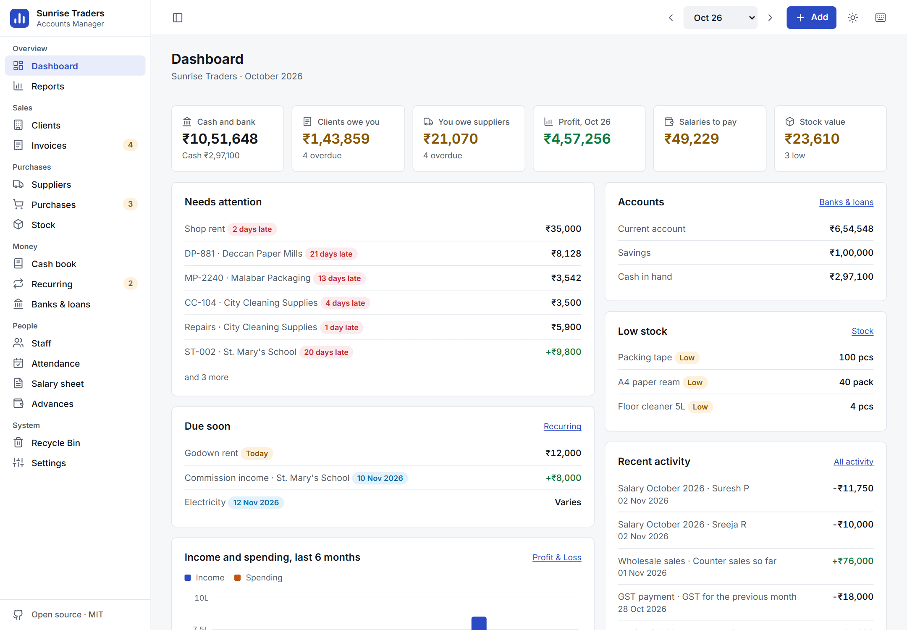
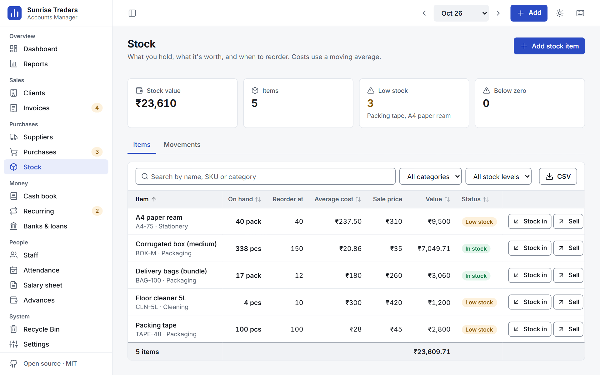
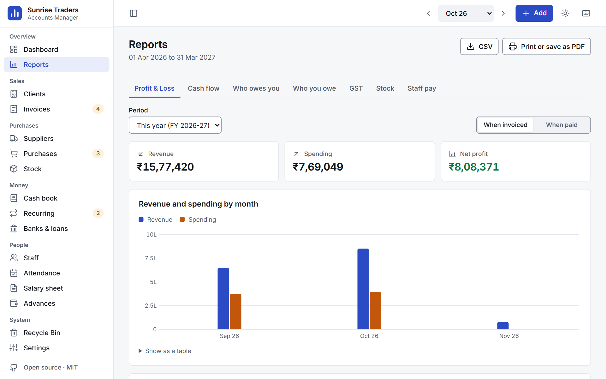
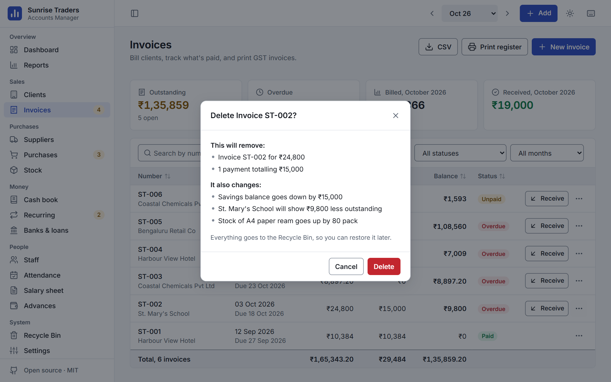
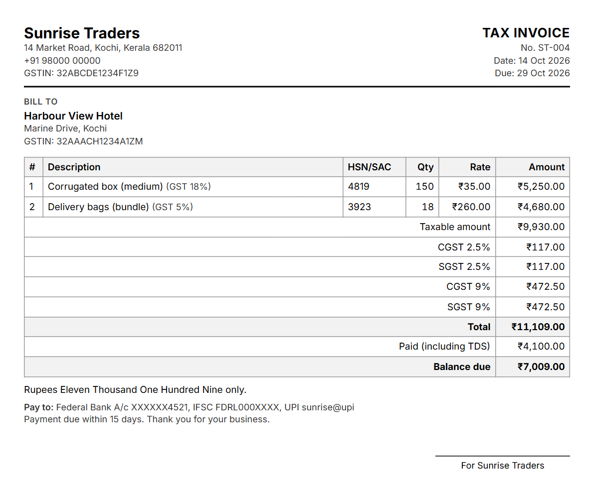
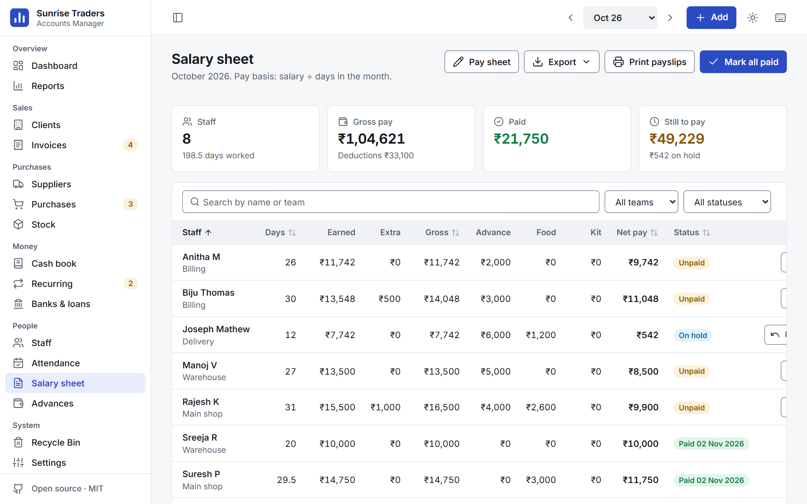
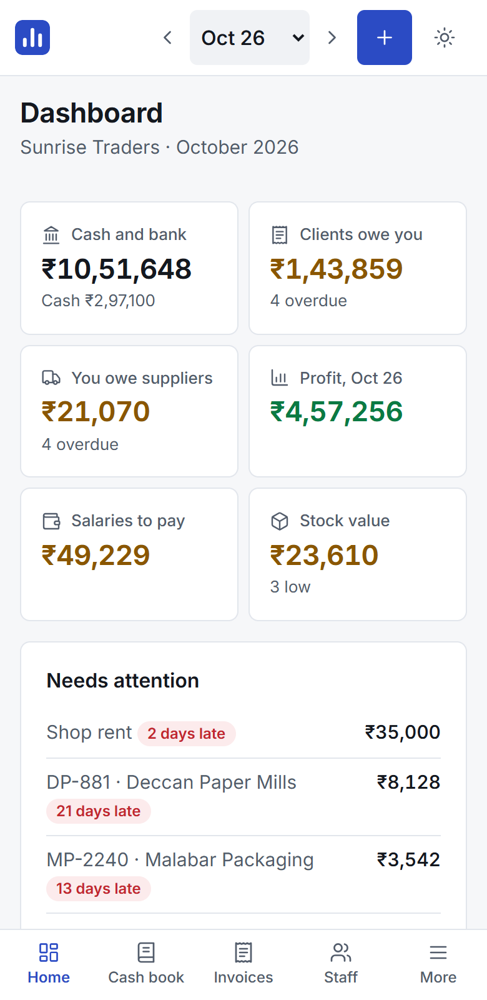

# Accounts Manager

**Free, private accounts for small businesses.** Payroll, GST invoices, stock, suppliers, banks and reports in one place, running entirely in your browser. There's no sign-up and no server, and your records never leave your device.

**[Open the app](https://royal-chemistry.github.io/Accounts_Manager/)**, then choose **Explore with sample data** to look around first.

[](https://github.com/Royal-chemistry/Accounts_Manager/actions/workflows/test.yml)
[](LICENSE)


## Who it's for

Accounts managers and owners of small businesses who keep their books in a notebook or a tangle of spreadsheets: shops, restaurants, service firms, workshops, builders, manpower agencies, clinics and traders.

Tell it what kind of business you run, and it starts you with suitable expense categories and stock units. Everything can be changed later.

<picture>
  <source media="(prefers-color-scheme: dark)" srcset="docs/images/dashboard-dark.png">
  
</picture>

## What it does

### Money coming in
- **GST invoices** with CGST and SGST, or IGST for other states, worked out from the GSTIN. Mixed tax rates, or enter a total and let it extract the tax.
- **Part payments and TDS**, overdue tracking, and print-ready tax invoices with your logo and the amount in words.
- **Clients** with their outstanding balance, opening balance and a one-click **Settle** that clears their oldest invoices first.

### Money going out
- **Suppliers and purchases** with bills, part payments and what you still owe.
- **Cash book** for everyday income and expenses. Personal spending stays out of profit.
- **Recurring payments** such as rent and EMIs, monthly to yearly, with fixed or variable amounts, due-soon alerts and history.

### Every money entry has a payment mode
**Cash, Bank (pick the account), UPI or Credit.** Credit purchases become what you owe, and credit sales become what you're owed. Balances are always worked out from your records, so they can't drift.

### People
- **Staff** with detail pages showing their pay, advance and attendance history.
- **Attendance grid** (present, half day, leave, absent), or just type in the days.
- **Salary sheet** with extra shifts, bonus, food, kit, optional PF and ESI, salary on hold, printable payslips, a bulk payout CSV and a WhatsApp summary.
- **Advances** that come off the right month's pay automatically.

### Stock, if you want it
Switch it on in Settings. Items with SKU, prices and GST rate, stock in and out for sale, usage or damage, moving average cost, valuation, item history and low-stock alerts. Invoice lines can reduce stock too.



### Banks and loans
Live balances for every account, transfers, statements, a "match to bank statement" adjustment, and loans with EMI, interest split and what's outstanding.

### Reports
Monthly or any date range, each with CSV export and a print layout that also saves as a PDF:

| Report | What it answers |
|---|---|
| **Profit & Loss** | Did we make money? Counted when invoiced, or when paid |
| **Cash flow** | Where did the money go, and does it match the bank? |
| **Who owes you** and **Who you owe** | How late is each balance, by age? |
| **GST summary** | Tax collected against tax on purchases, and what's left to pay |
| **Stock** | What moved, what's left and what it's worth |
| **Staff pay** | Gross, deductions, paid and pending, by person and team |



### Hard to lose your work
- **Nothing is deleted without a warning** that says exactly what else is affected.
- **A Recycle Bin** with restore and permanent delete, plus an 8-second **Undo** after every delete.
- **Backup and restore** to a file, with a reminder, and a safety copy kept whenever data is replaced.
- **Upgrades are checked.** Saved data is converted and verified before it's used, and the old copy is kept.



### Pleasant to use all day
Light and dark themes that follow your system, sorting, search and filters on every table, keyboard shortcuts (press `?` to see them), clear focus states, and layouts that work from a phone to a wide monitor. Every page is tested against WCAG AA, and the app works offline once loaded.

| Invoice | Salary sheet | On a phone |
|---|---|---|
|  |  |  |

## How pay is calculated

```
per-day rate = monthly salary ÷ divisor          (days in the month, 30 or 26, your choice)
basic pay    = round(per-day rate × days worked)
gross        = basic pay + extra shifts × shift rate + bonus
deductions   = advance + food days × food rate + uniform or kit + other + PF + ESI
net pay      = gross − deductions
```

- **PF (optional):** 12% of basic pay, on wages up to ₹15,000.
- **ESI (optional):** 0.75% of gross, when gross is ₹21,000 or less.

Please check these against your own registration and the current rules before relying on them.

## Quick start

**To use it**, just [open the app](https://royal-chemistry.github.io/Accounts_Manager/). There's nothing to install.

**To run your own copy**, you need [Node](https://nodejs.org) 22 or newer for the small local server:

```bash
git clone https://github.com/Royal-chemistry/Accounts_Manager
```

```bash
cd Accounts_Manager
```

```bash
npm start
```

Then open <http://localhost:4173>. Any static file server works too, as there's no build step.

**To host your own copy for free**, fork this repo and turn on **Settings, Pages, Deploy from a branch, main**.

## Your privacy

- Your records stay in your browser's storage on your device. They're never uploaded, because there's no server to send them to.
- The app contains no analytics, trackers, ads or third-party scripts, and its Content Security Policy blocks connections to other servers.
- Fonts and icons ship with the app, so loading it makes no requests elsewhere.
- WhatsApp links only open a chat with the message filled in. Nothing is sent unless you press send.

Browser storage isn't encrypted, so anyone using your browser profile can see your records. Use your device's own account lock, and keep backup files somewhere safe.

## FAQ

**Is it really free?**
Yes, under the MIT licence. There are no paid tiers, limits or sign-ups.

**Where is my data, and how do I move it to another computer?**
It's in the browser you use, on that device only. To move it, use **Settings, Download backup**, then **Restore** on the other device.

**Could I lose my data?**
Clearing your browser's site data removes it, as can reinstalling the browser or a failing disk, so download a backup regularly. The dashboard reminds you. Private or incognito windows forget everything when closed, so don't use them for real records.

**I use Safari or an iPhone. Is there anything special to know?**
Safari can delete a website's stored data if you haven't visited it for 7 days of browser use. Adding the app to your Home Screen exempts it, but regular backups are the safest answer on any Apple device.

**How much can it hold?**
Browsers usually allow about 5 MB, which is years of records for a small business. **Settings** shows how much you've used, and if a save ever fails, the app tells you straight away so you can download a backup. A large logo uses the most, so the app shrinks logos when you add them.

**Can two people use it at once?**
Not on separate devices, since nothing is synced. If you have the app open in two tabs on one browser, they stay in step.

**Is the GST or payroll treatment legally correct for me?**
It's a working record to make your accounts easier, not tax or legal advice. PF and ESI follow the common rules below and can be switched on or off. Please check the figures with your accountant before filing.

**I used the old version. What happens to my data?**
It's upgraded automatically the first time you open the new version. The upgrade checks every total against your old figures before switching over, and your old data is left untouched as a fallback.

**Does it work without internet?**
Yes. After your first visit it loads and works offline.

**Is my currency supported?**
Rupees are the default, and you can choose others in Settings. GST features can be switched off if they don't apply to you.

## Roadmap

Ideas for later, roughly in order. Tell us which would help you most.

- Recovering an advance over several months
- Credit notes and returns
- Financial-year invoice numbering
- Uniform or kit issue linked to pay deductions
- Team transfer history
- Double-entry journal and trial balance
- Optional passcode

Logins, cloud sync and email reminders aren't planned, because each needs a server, and running without one is the point of this tool.

## Contributing

Bug reports and pull requests are welcome. See [CONTRIBUTING.md](CONTRIBUTING.md) for how to run the tests and how the code is organised, and [CHANGELOG.md](CHANGELOG.md) for what's changed.

It's plain HTML, CSS and JavaScript with native modules, with no framework, no build step and no runtime dependencies.

## Licence

[MIT](LICENSE) © 2026 Aldrin Ann Thomas
