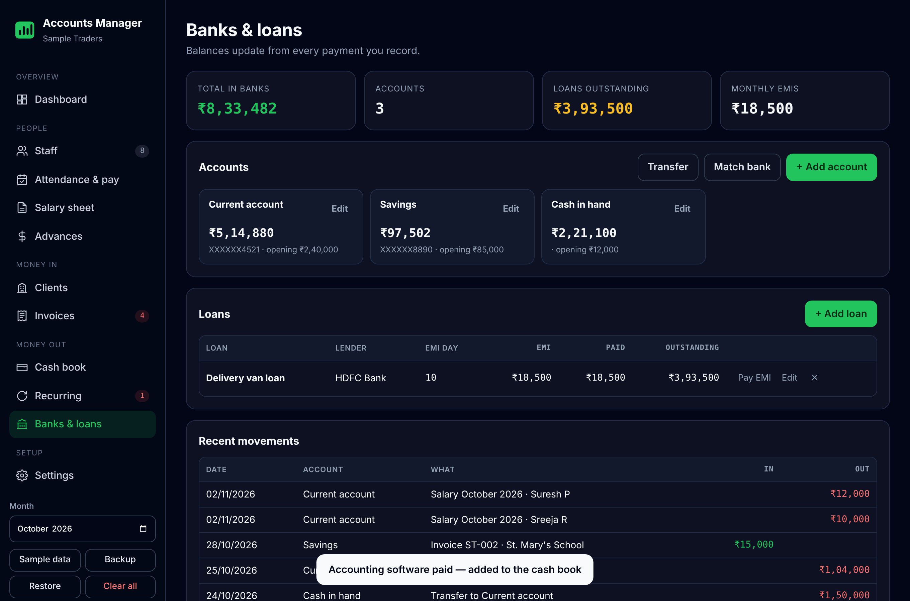
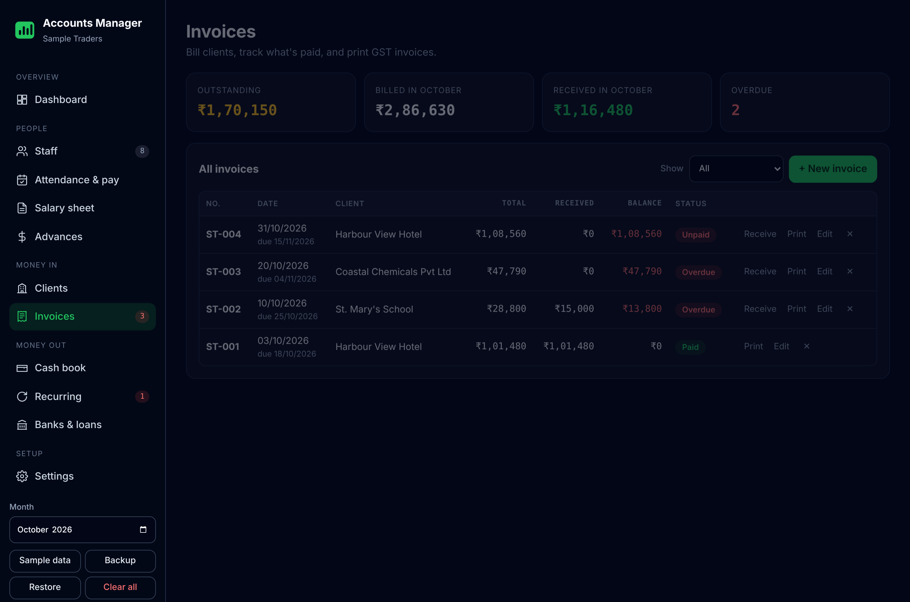

# 📊 Accounts Manager

**Free accounts for small businesses:** payroll, advances, invoices, banks, loans, recurring payments and a cash book in one place, with your real profit every month.

It runs entirely in your browser. There's no sign-up and no server, and your data never leaves your device.

**[▶ Open the app](https://royal-chemistry.github.io/Accounts_Manager/)**, then click **Load sample data** to try it.


## Who it's for

Any small business that pays people **by the day or shift** and keeps its accounts in a notebook or a messy spreadsheet:

- 🛍️ Shops, supermarkets and bakeries
- 🍽️ Restaurants, cafés and hotels
- 🏗️ Construction, painting and maintenance crews
- 🧹 Cleaning, housekeeping and facility services
- 🛡️ Security and manpower agencies
- 🏥 Clinics, salons, workshops, tuition centres…

Most payroll software is built for office staff on fixed salaries, with HR modules and monthly fees. This one does the everyday job: who worked how many days, what advances they took, what you owe them, and where the month's money went.

## Features

| Area | What you get |
|---|---|
| **Dashboard** | Money in banks, what clients owe you, salaries still to pay, this month's profit, payments due soon |
| **Staff** | Name, team/branch, salary, bank, IFSC, UPI. Edit inline or import a CSV |
| **Attendance & pay** | Days worked, extra shifts, bonus, food, uniform/kit and other cuts. Net pay updates as you type |
| **Salary sheet** | Totals by team, mark salaries paid from an account, printable payslips, payout CSV for bulk transfer, WhatsApp summary |
| **Advances** | Log advances by date. They come off that month's pay automatically |
| **Clients & invoices** | GST or non-GST invoices with numbering, part payments, TDS, overdue tracking and print-ready tax invoices (CGST/SGST split) |
| **Cash book** | Income and expenses by category and account, CSV export, with real monthly profit including salaries, invoices and EMIs |
| **Recurring payments** | Rent, subscriptions, EMIs and SIPs by due day. One tap marks them paid and adds them to the cash book |
| **Banks & loans** | Live balance per account from every payment, transfers, "match to bank statement" adjustment, loans with EMI and outstanding balance |

Also: three pay bases (÷ days in month, ÷ 30, ÷ 26), optional PF/ESI, backup and restore, and a dark, phone-friendly design. It works offline once loaded.





## How pay is calculated

```
per-day rate = monthly salary ÷ divisor          (divisor = days in month, 30 or 26)
basic pay    = round(per-day rate × days worked)
gross        = basic pay + extra shifts × shift rate + bonus
deductions   = advance + food days × food rate + uniform/kit + other + PF + ESI
net pay      = gross − deductions
```

- **PF (optional):** 12% of basic pay, on wages up to ₹15,000.
- **ESI (optional):** 0.75% of gross, when gross is ₹21,000 or less.

Check these rates against your own registration and the current rules before relying on them.

## Run it yourself

It's plain HTML, CSS and JavaScript with no build step.

```bash
git clone https://github.com/Royal-chemistry/Accounts_Manager
cd Accounts_Manager
npx serve .          # or any static server, then open http://localhost:3000
npm test             # runs the calculation tests (Node 20+)
```

To host your own copy for free, fork the repo and turn on **Settings → Pages → Deploy from branch → main**.

## Your data

Everything is stored in your browser's local storage on that device only. Clearing browser data removes it, so use **Backup** regularly. The sample data uses made-up names and account numbers.

## Ideas welcome

- Daily attendance sheet (tick per day) that fills in days worked
- Bank-specific bulk-payment formats (SBI, Federal, HDFC…)
- Customer invoices and GST summary from the cash book

Open an issue or a pull request.

## Licence

MIT © 2026 Aldrin Ann Thomas
