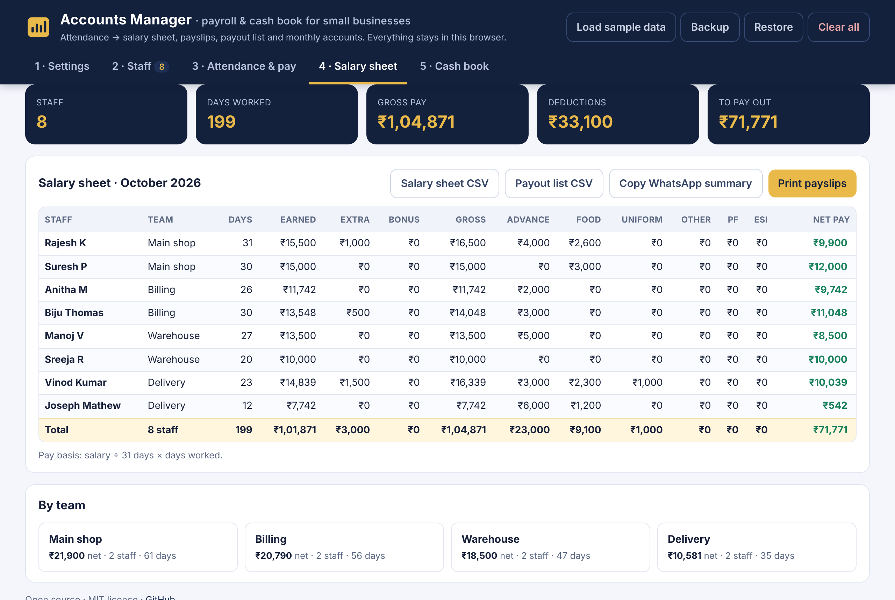
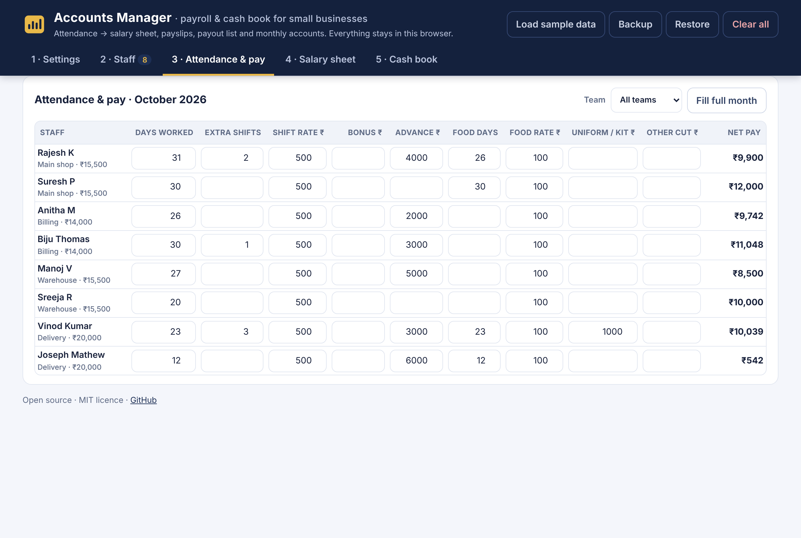
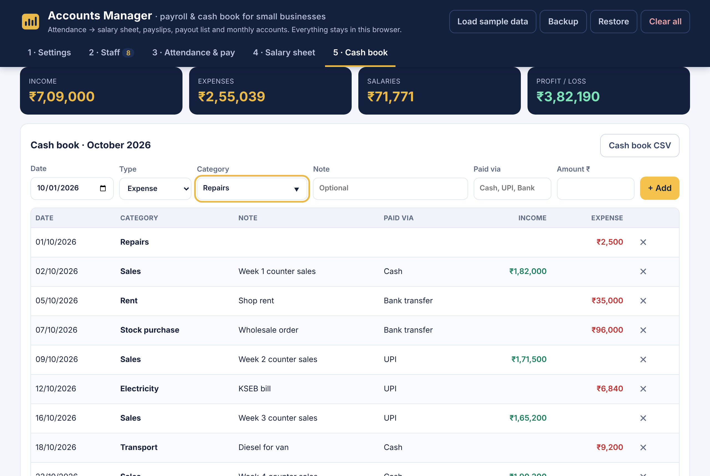

# 📊 Accounts Manager

**Free payroll and cash book for small businesses.** Enter your staff's days worked and get a salary sheet, printable payslips and a bank/UPI payout list. Keep a simple income and expense book alongside it, and see your real profit each month.

It runs entirely in your browser. There's no sign-up and no server, and your data never leaves your device.

**[▶ Open the app](https://royal-chemistry.github.io/Accounts_Manager/)**, then click **Load sample data** to try it.



## Who it's for

Any small business that pays people **by the day or shift** and keeps its accounts in a notebook or a messy spreadsheet:

- 🛍️ Shops, supermarkets and bakeries
- 🍽️ Restaurants, cafés and hotels
- 🏗️ Construction, painting and maintenance crews
- 🧹 Cleaning, housekeeping and facility services
- 🛡️ Security and manpower agencies
- 🏥 Clinics, salons, workshops, tuition centres…

Most payroll software is built for office staff on fixed salaries, with HR modules and monthly fees. This one does the everyday job: who worked how many days, what advances they took, what you owe them, and where the month's money went.

## Features

**Payroll**
- **Staff list:** name, team/branch, monthly salary, bank account, IFSC and UPI. You can import a CSV.
- **Monthly attendance and pay:** days worked, extra shifts, bonus, advance, food, uniform/kit and other cuts. Net pay updates as you type.
- **Three pay bases:** salary ÷ days in that month, ÷ 30, or ÷ 26. You can also cap pay at the monthly salary.
- **Optional PF and ESI** employee deductions.
- **Salary sheet** with totals and a **per-team summary**.
- **Printable payslips:** one per person per page, with the amount in words.
- **Payout list CSV** with name, amount, account, IFSC and UPI, ready for bulk transfer.
- **WhatsApp summary:** one tap copies the month's pay as text.
- **Flags anyone who owes you money,** where deductions are more than pay, and leaves them out of the payout.

**Cash book**
- **Income and expenses** with date, category, note and payment method (cash, UPI, bank…).
- **Monthly totals by category.**
- **Profit or loss for the month,** with salaries from the salary sheet included automatically.
- **CSV export** for your accountant.

**Everywhere:** backup and restore as one file, works on phones, and works offline once loaded.




## How pay is calculated

```
per-day rate = monthly salary ÷ divisor          (divisor = days in month, 30 or 26)
basic pay    = round(per-day rate × days worked)
gross        = basic pay + extra shifts × shift rate + bonus
deductions   = advance + food days × food rate + uniform/kit + other + PF + ESI
net pay      = gross − deductions
```

- **PF (optional):** 12% of basic pay, on wages up to ₹15,000.
- **ESI (optional):** 0.75% of gross, when gross is ₹21,000 or less.

Check these rates against your own registration and the current rules before relying on them.

## Run it yourself

It's plain HTML, CSS and JavaScript with no build step.

```bash
git clone https://github.com/Royal-chemistry/Accounts_Manager
cd Accounts_Manager
npx serve .          # or any static server, then open http://localhost:3000
npm test             # runs the calculation tests (Node 20+)
```

To host your own copy for free, fork the repo and turn on **Settings → Pages → Deploy from branch → main**.

## Your data

Everything is stored in your browser's local storage on that device only. Clearing browser data removes it, so use **Backup** regularly. The sample data uses made-up names and account numbers.

## Ideas welcome

- Daily attendance sheet (tick per day) that fills in days worked
- Bank-specific bulk-payment formats (SBI, Federal, HDFC…)
- Malayalam, Hindi and Tamil translations
- Customer invoices and GST summary from the cash book

Open an issue or a pull request.

## Licence

MIT © 2026 Aldrin Ann Thomas
